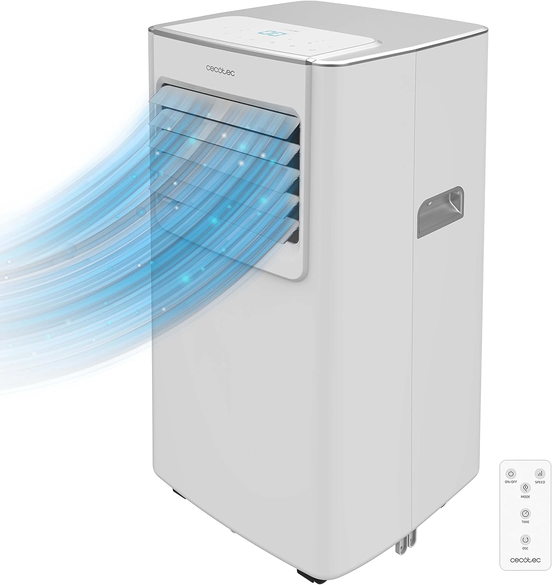
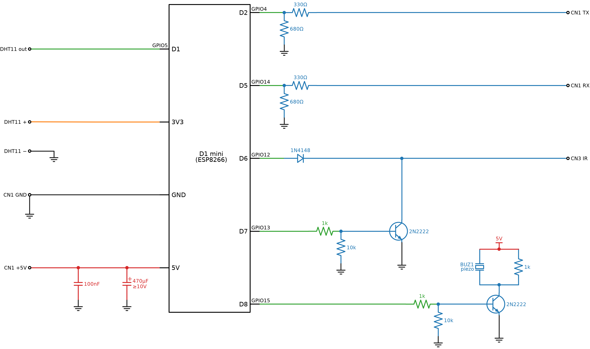

# Cecotec portable AC – ESPHome

Local Home Assistant control for a [Cecotec portable air conditioner](https://www.amazon.de/dp/B0BPZHKY25). A Wemos D1 mini inside the unit reads the state from the bus between the display board and the main board (CN1), and presses keys by injecting IR remote codes. No cloud, original panel and remote keep working.



## Features

- Climate entity: off / cool / dry / fan, setpoint 16–31 °C, fan low/high, sleep preset
- Dry mode as humidity control (DHT sensor + hysteresis)
- AC timer: hours, +1h / −1h, off
- Room temperature and humidity
- Buzzer moved to the ESP (avoids beeping everytime the esp is controlling the ac): AC/remote buttons beep, mute switch, volume, error, status and other fun melodies
- Unknown-value watch: flags unseen CN1 frames (e.g. water tank full) in HA

## Files

| Path | Content |
| --- | --- |
| [cecotec-ac.yaml](cecotec-ac.yaml) | ESPHome config |
| [cecotec/components/cecotec_ac/](cecotec/components/cecotec_ac/) | climate component |
| [cecotec/cn1_decode.h](cecotec/cn1_decode.h) | CN1 frame decoder, unknown-value watch |
| [cecotec/melodies.h](cecotec/melodies.h) | RTTTL melodies |
| [FINDINGS.md](FINDINGS.md) | CN1 protocol, key codes, IR codes, firmware behaviour |
| [wiring.md](wiring.md) | wiring, schematics, safety notes |
| [tools/](tools/) | MIDI → RTTTL converter |
| [pics/](pics/) | photos of the unit, board and wiring, demo video |

## Wiring



Details and per-circuit notes: [wiring.md](wiring.md).

## Setup

1. Wire the D1 mini as above.
2. Flash over USB or OTA (if esp already setup for esphome): `esphome run cecotec-ac.yaml`

> **Flashing from the ESPHome Device Builder (Home Assistant):** the dashboard only edits YAML, so copy the files into `/config/esphome/` yourself (e.g. with the Samba share or Studio Code Server add-on):
>
> ```text
> /config/esphome/
> ├── cecotec-ac.yaml
> └── cecotec/
>     ├── cn1_decode.h
>     ├── melodies.h
>     └── components/cecotec_ac/   (__init__.py, climate.py, cecotec_ac.h, cecotec_ac.cpp)
> ```
>
> Copy the files again after every change, otherwise the dashboard builds the old version.

## Disclaimer

This means opening a mains-powered appliance, which voids its warranty. Unplug the unit before working on it. Use at your own risk.

**AI usage:** Most of the code, the protocol analysis and the documentation were written with an AI assistant.
