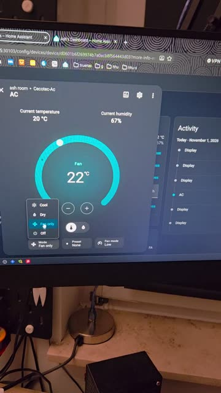
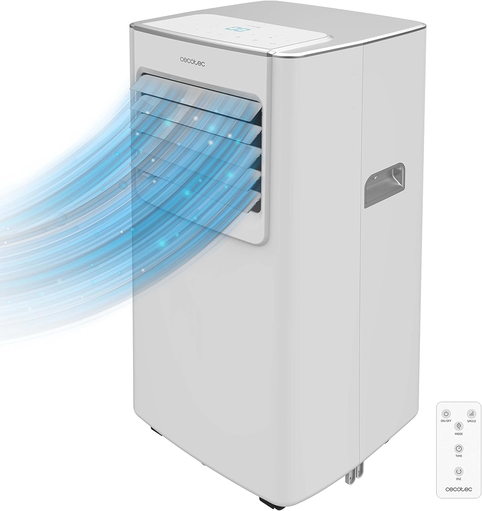

# Demo

## Video

Controlling the AC from Home Assistant: mode, setpoint, fan speed (demo.mp4).

## The unit

 

DHT sensor taped to the side of the unit for room temperature and humidity.

## Display board

 

Front: keys, 7-segment display, buzzer, CN1 (to main board) and CN3 (IR receiver). Back: MCU K6CQGTH.

## Wiring

 

Wemos D1 mini + perfboard with dividers, IR injection and buzzer driver. Schematic: [wiring.md](../wiring.md).
