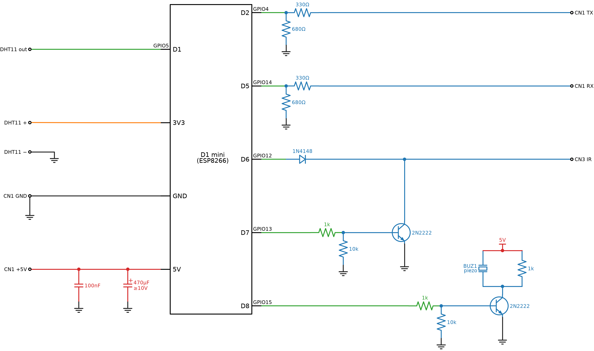
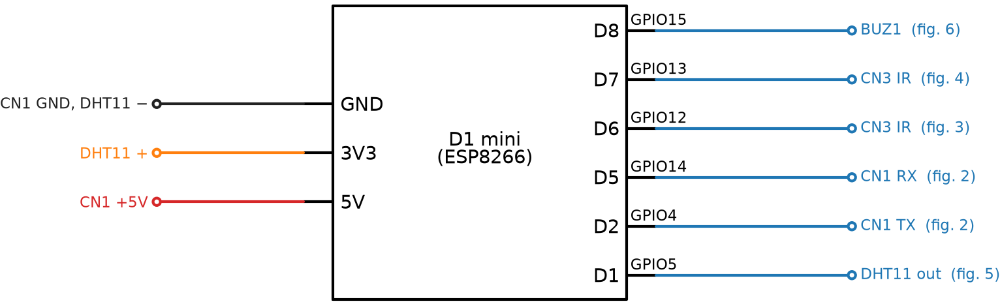
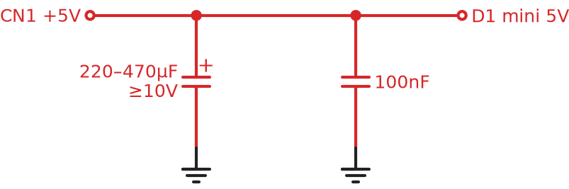
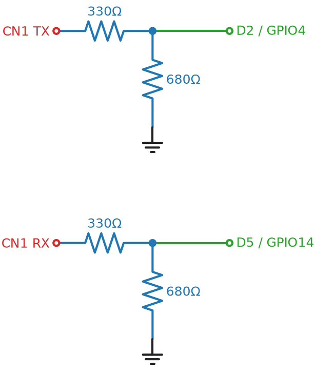
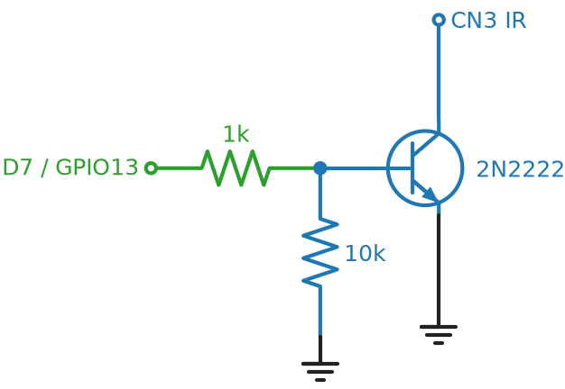
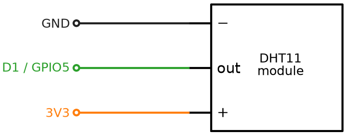
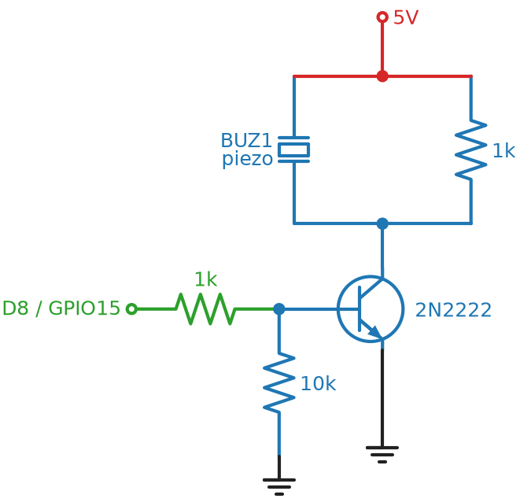

# Cecotec AC – D1 mini wiring

Board: JRS-AD19D-LED-DM (display board, MCU K6CQGTH)

## Connectors (labels are from the display board's point of view)

- **CN1**: +5V / GND / RX / TX. Link to the main board (pulse-distance protocol, not UART, see [FINDINGS.md](FINDINGS.md)). All lines idle at 5V.
- **CN3**: +5V / GND / IR. IR receiver module. Weak pull-up of about 15kΩ (4.78V idle, 1.94V with 10k to GND).
- **CN2**: RST / +5V / GND / SDA / SCK. MCU programming header. Not used.

## Connections

Diagrams are drawn with [schemdraw](https://schemdraw.readthedocs.io). To change one, edit [diagrams/make_diagrams.py](diagrams/make_diagrams.py) and run `python make_diagrams.py --png` in that folder (needs `pip install schemdraw matplotlib`).

Wire colors: red = 5V, orange = 3V3, black = GND, green = ESP pin, blue = signal.

### Full schematic (everything on one sheet)

- Open circles are the points where you solder to the AC: CN1, CN3 and the DHT11 pins.
- CN3 IR is a single wire on the board. The D6 diode and the D7 transistor both connect to it (the dot on the blue line).
- All ground symbols are the same GND net. The buzzer's 5V is the same 5V that comes from CN1 +5V.

The figures below show each circuit on its own with extra notes.

| D1 mini      | Goes to   | Via                                        | Purpose                     |
|--------------|-----------|--------------------------------------------|-----------------------------|
| 5V           | CN1 +5V   | direct                                     | Power                       |
| GND          | CN1 GND   | direct                                     | Ground                      |
| 5V ↔ GND     | —         | 220–470µF electrolytic (≥10V) + 100nF ceramic, at the D1 pins | WiFi current spikes |
| D2 (GPIO4)   | CN1 TX    | 330Ω / 680Ω divider (~3.4V idle)           | Sniff display → main        |
| D5 (GPIO14)  | CN1 RX    | 330Ω / 680Ω divider (~3.4V idle)           | Sniff main → display        |
| D6 (GPIO12)  | CN3 IR    | 1N4148: anode at D6, cathode (stripe) at IR line; internal pull-up on | Sniff IR (remote) |
| D7 (GPIO13)  | CN3 IR    | 2N2222 open-collector circuit (below)      | Inject IR commands          |
| D1 (GPIO5)   | DHT11 out | direct (module has its own pull-up)        | Room temperature / humidity |
| 3V3          | DHT11 +   | direct                                     | Sensor power (**not 5V**)   |
| D8 (GPIO15)  | BUZ1      | 2N2222 low-side driver (below)             | Beeper, driven by the ESP   |

Do not use RX (GPIO3) for CN1 TX. The D1 mini's USB chip drives RX through 470Ω, and the divider can't pull it low. It was moved to D2.

## Power (5V, GND, buffer caps)

## Voltage divider (TX and RX lines)

- 5V × 680 / (330 + 680) ≈ 3.37V calculated, **3.0V measured** idle at the ESP pin: the ~5mA load pulls the CN1 line down to about 4.45V.
- 3.0V is a clean HIGH (ESP8266 needs ≥ ~2.5V, max 3.6V) and frames decode error-free.
- 1k/2k would cut the load to ~1.7mA (~3.2V at the pin), if a board ever misbehaves.

## IR sniff (D6)

- No divider: it would collapse the weak 15k pull-up.
- Line high: the diode blocks and D6 is pulled up internally.
- Line low: D6 sits at about 0.6–0.7V and reads LOW. Tight margin. A BAT85 Schottky would give more margin.
- Test: short IR to GND and check that D6 reads under 0.75V.

## IR inject (D7, 2N2222)

- D7 HIGH → transistor on → IR line pulled to about 0.1V (looks like IR active).
- D7 LOW → transistor off → the 15k pull-up restores 5V.
- The 10k from base to GND keeps it off during boot.
- Wired-AND, so the original remote still works.
- The ESP only sees the base side (≤0.7V). No pin ever sees 5V.
- Pinout varies: PN2222A TO-92 = E-B-C (flat face toward you); P2N2222A = C-B-E. Check with the multimeter's diode test.

## DHT11 module (D1)

The pin order on the module varies, so follow the labels printed on it, not the order in the figure.

- Power it from 3V3, not 5V. The data line is pulled up to the supply voltage, and 5V on an ESP pin would damage it.
- 3-pin modules already have the pull-up resistor (usually 10k, marked "103"). A bare 4-pin sensor needs 4.7k–10k from data to 3V3, and pin 3 stays unconnected.
- Mount it outside the AC airflow and away from the main board, ideally near the air intake. Otherwise it measures the AC instead of the room.
- Keep the cable short (under about 1–2 m at 3.3V).
- The module is sold as DHT11 but sends the DHT22/AM2302 format (0.1 steps), so the YAML uses `model: DHT22`.

## Buzzer (D8, 2N2222)

BUZ1 (17mm passive piezo) is removed from the display board and driven by the ESP only. Its board pads stay unconnected.

- The 1k across the piezo discharges it. Without it, a piezo only clicks once instead of beeping.
- A piezo has no polarity.
- The ESP generates the tone (PWM, ~2.7kHz). The 5V swing is louder than driving the piezo from a 3.3V pin.
- D8 must be LOW at boot. The D1 mini's onboard 10k pull-down and the 10k base resistor keep it low.
- BUZ1 sits behind the front panel's sound hole (hot glue) on two thin wires. Reversible: it can be soldered back onto the display board.
- If the ESP is off, the AC is silent.

## Safety

- Verify that the main board's 5V is isolated from mains.
- Never connect USB to a PC while the D1 mini is wired into the unit. Flash over USB first, then use OTA only.
- All the pins used (GPIO4, 5, 12, 13, 14, 15) are boot-safe as wired. GPIO15 is safe only because it is pulled low; never pull it high.
- No ESP pin ever sees 5V: the CN1 lines go through dividers, the IR line through a diode or transistor, the beeper through a transistor, and the DHT11 runs on 3V3.

## Pin usage overview

| Pin | GPIO | Use | Boot note |
|---|---|---|---|
| D1 | 5  | DHT11 | free |
| D2 | 4  | CN1 TX sniff (display → main) | free |
| D3 | 0  | — | boot strap (must be HIGH), keep free |
| D4 | 2  | — (onboard LED) | boot strap (must be HIGH), keep free |
| D5 | 14 | CN1 RX sniff (main → display) | free |
| D6 | 12 | IR sniff | free |
| D7 | 13 | IR inject | free |
| D8 | 15 | Buzzer | boot strap (must be LOW), OK with the NPN |
| RX | 3  | — | USB chip holds it high, unusable for sniffing |
| TX | 1  | — | serial log output (disabled) |
| A0 | ADC | — | free (analog only, max 3.2V on D1 mini) |
